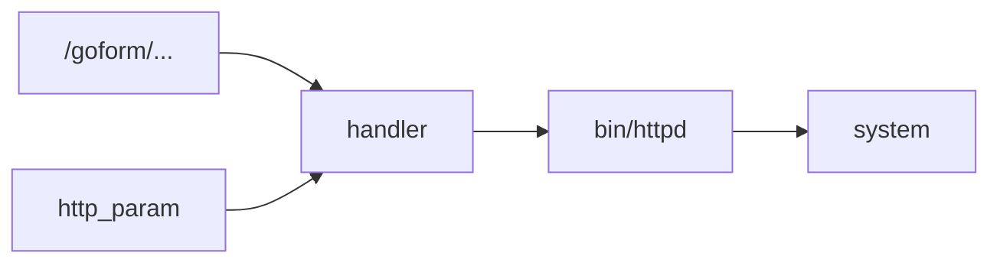

# FirmHound 设计取舍与技术路线

> 记录关键技术选型的取舍：为什么这样设计、哪些说法属于过度承诺、与同类方案的边界在哪、后续往哪走。可作为设计文档、技术报告和对外介绍的共同表述。

## 1. 系统定位

面向 IoT 固件漏洞挖掘的 CLI 流水线。输入是厂商固件镜像，输出是带证据和反证的候选清单。解包、攻击面恢复、二进制审计、风险评分、反证验证、动态验证、报告生成都在同一个阶段机里跑：状态可恢复，产物可审计，缺工具时降级。

大模型是可选件。默认 offline 运行；接入模型只用于任务理解、动作排序和报告措辞，
不参与漏洞判定。`AGENT_LOOP` 中模型只在规则筛出的合法动作里选择一个，动作本身由
确定性工具执行，结论仍由反证验证器裁决。

## 2. 不该当作差异点的说法

下面几条是同类系统的通用能力，写进介绍容易被追问：

- 用了大模型 / 有智能体 / 会自动调用工具 / 会生成 Harness / 能让 Agent 自主挖洞。

原因：同类系统都在做；对模型幻觉有默认戒心；Harness 只解决验证手段，不解决结论可信度。

## 3. 关键设计决策

### 3.1 证据先于结论

结果是一条可追溯的链路：

```text
输入样本 -> 阶段执行 -> 中间产物 -> 候选生成 -> 评分依据 -> 反证审查 -> 最终结论
```

实现：`EvidenceStore`、`DecisionStore`、`runs/<run_id>/{evidence,decisions}/`，
candidate / verdict / evidence / decision 四个 Schema。

约束：每个候选必须绑定 `source`、`sink`、`call_chain`、`validation`、`authorization`、
`evidence`、`counterevidence`；字段缺失的候选不进报告。

### 3.2 反证优先

静态 source/sink 共现直接出结论会产生大量误报。系统先找能推翻候选的证据，再决定是否升级。

实现：10 问审计清单、12 条硬规则、`counterevidence` 字段、
`ACCEPT / DOWNGRADE / REJECT / NEED_DYNAMIC` 四种裁决、五类结论
（confirmed-issue / high-confidence-candidate / false-positive / unknown / observation）。

规则：证据不足时输出 `NEED_DYNAMIC` 或 `unknown`，不出高危告警。

### 3.3 降级可解释

工具缺失、固件加密、符号执行超时都会发生。系统保证每次失败都有状态、有原因、有下一步。

实现：

- 每个工具返回 `status`；`degraded` / `skipped` 由引擎判为 partial，走 `TRANSITIONS` 里的 fallback。
- `fsa doctor` 报告工具可用性与当前发行版。
- KLEE 超时或路径爆炸不改分，只记 `limitation`。
- BOND 没有 `poc_sanitized=true` 的 trigger 不确认漏洞。
- BE3LPro 这类加密固件识别为 OpenSSL Salted，保留加密切片，提示需要密钥材料。

### 3.4 安全约束写进代码

实现：`config/safety.yaml` 控制路径白名单、命令黑名单、私有网段；动态验证设四道门
（`AUTHORIZED` / `LOCAL_LAB` / `PRIVATE_NETWORK` / `BASELINE_READY`）；PoC sanitizer；
报告合规扫描。

边界：不做未授权目标，不产出可武器化内容。这些限制在策略引擎里强制，不依赖文档约定。

### 3.5 固件前处理

真实固件上修过的问题：binwalk 表格解析、外部工具非交互调用与超时、SquashFS 魔数切片、
sasquatch 非标准格式、gzip 噪声抑制、空目录误判、符号链接容错、加密载荷识别。

这些决定能不能拿到可信 rootfs。拿不到 rootfs，后面的分析没有意义。

### 3.6 Blind 与复发检测隔离

FirmRec 只用于复发专项。Blind Run 由代码断言禁用，并在决策日志写 `FORCED_DISABLE`；
结果落 `recurrence_findings.json`，不进 `unified_candidates.json`。

### 3.7 受控自主执行（AGENT_LOOP）

在 `RANK` 与 `VERIFY_TOP_K` 之间可选插入一个有界循环：规则先按候选的
`decisive_missing_fact` 筛出合法动作；模型只在 2–4 个动作里排序/选择一个；动作由
确定性工具执行，只补齐调用链、startup、imports/strings、auth、证据引用等事实。
模型只在规则筛出的合法动作里排序/选择；工具名、路径、参数和结论由代码产生；Agent 只写事实字段，结论字段由反证验证阶段产生
`conclusion_category` / `status` / `risk_level`。

默认关闭，`--agent` 或 `agent.enabled=true` 才启用；Blind Run 强制禁用；`standard`
tier 不联网、不仿真；`dynamic` / `external` 需要显式参数。每次动作写
`decisions/dec-*.json`，轨迹写 `artifacts/agent_trace.json`，报告第 24 节只渲染计数，
不渲染模型原文。

## 4. 定位表述的几种写法

按场景选择一句，保持全文一致。

- 简短：把固件分析的每一步落成可复核的证据。
- 技术：Evidence-first firmware vulnerability agent。
- 正式：FirmHound 把固件解包、静态审计、反证验证与受控动态验证串成一条可追溯、可恢复、可降级的 CLI 工作流。
- 口头：某个候选从哪里来、为什么可疑、还缺什么验证，系统里都查得到。

## 5. 能力分层

对外讲这套系统按三层讲，每层都有可验证的产物。

**第一层：能跑真实固件**
解包 → rootfs 识别 → 攻击面恢复 → 二进制扫描 → 报告生成。

**第二层：结论可核**
每条候选绑定证据；每次决策可追溯；证据不足不出确认结论；误报主动降级。

**第三层：边界清楚**
加密固件不伪造成功；缺工具不崩溃；动态验证过安全门；Blind 与 recurrence 两条链路隔离。

## 6. 演进方向

按投入产出比排序，前三个建议优先做。

### 方向 A：漏洞证据账本 Vulnerability Evidence Ledger

### 要做什么

把每次运行的 evidence、decision、candidate、verdict 串成一份“漏洞证据账本”，让读者能看到每个结论的完整来源。

### 设计依据

普通 Agent 输出自然语言报告；FirmHound 输出可追踪证据账本。

### 可以开发什么

新增命令：

```bash
fsa explain <run-id> --candidate <candidate-id>
```

输出：

- 候选来源。
- 关联攻击面。
- source。
- sink。
- 支持证据。
- 反证。
- 风险评分每一维。
- 当前结论。
- 下一步建议。

### 图表建议

- 候选生命周期图：new -> ranked -> verified -> need_dynamic/confirmed/rejected。

### 优先级

极高。这个最贴合现有架构，改动小，展示效果强。

### 方向 B：固件可解包性诊断 Firmware Unpackability Diagnosis

### 要做什么

输出包含失败原因、卡住的层级、下一步需要的材料，不止一句“解包失败”。

### 当前基础

BE3LPro 已经识别 OpenSSL Salted 加密载荷。

### 可以开发什么

新增或强化：

```bash
fsa unpack-diagnose firmware.bin --json-output
```

输出：

- magic signatures。
- 可能文件系统。
- 加密/压缩/自定义头判断。
- 已尝试工具。
- 失败原因。
- 需要材料：password/key/vendor upgrader/decrypted intermediate。
- 推荐下一步逆向路径。

### 设计依据

大部分队伍只关注漏洞验证，忽略固件解包这个第一难关。你们可以把“固件解包诊断”打成逆向分析特色。

### 图表建议

- 解包性诊断树。
- AC15 成功路径 vs BE3LPro 阻断路径。

### 优先级

高。固件逆向的前处理（解包、架构识别、rootfs 恢复）是本项目已有的强项，投入产出比最高。

### 方向 C：误报免疫机制 False-Positive Immunity

### 要做什么

把「少报假漏洞」作为优化目标，不追求候选数量。

### 当前基础

- 10 问反证。
- KLEE infeasible 只写 counterevidence。
- BOND 没有安全 trigger 不确认。
- OpenWrt 样本无高危候选。

### 可以开发什么

新增指标：

- `counterevidence_count`
- `downgraded_count`
- `need_dynamic_count`
- `confirmed_count`
- `false_positive_risk`
- `evidence_completeness_score`

在 report 里增加：

```text
误报控制摘要
- 候选总数
- 反证降级数量
- 需动态验证数量
- 已确认数量
- 证据完整度
```

### 设计依据

安全分析里“可信度”比“数量”更难。按这个标准，OpenWrt 无高危候选也是一条有效结论。

### 图表建议

- 漏斗图：raw candidates -> ranked -> verified -> need_dynamic/confirmed/rejected。

### 优先级

高。适合快速补进报告生成。

### 方向 D：零先验模式 Zero-Prior Mode

### 要做什么

面对全新固件时，系统进入零先验模式，自动禁用已知漏洞签名和复发检测，把所有结论标明是否依赖先验。

### 当前基础

- FirmRec Blind Run 隔离。
- benchmark 里已有 9 个 CVE，但不混入本次分析发现。

### 可以开发什么

新增参数：

```bash
fsa analyze firmware.bin --mode zero-prior
```

或：

```bash
fsa plan --blind-run
```

效果：

- FirmRec 强制关闭。
- report 写入“零先验声明”。
- candidate 标记 `prior_knowledge_used=false`。
- 如果用了 CVE 签名，必须单列 recurrence，不进入主榜。

### 设计依据

这能直接回答最常见的质疑：是不是背答案库？

### 图表建议

- 主轨/复发轨隔离图。

### 优先级

中高。已有基础，主要是命令与报告表述的补充。

### 方向 E：固件攻击面知识图谱 Firmware Attack Surface Graph

### 要做什么

把 Web route、handler、binary、startup、source、sink 组织成图，报告里可导出 Mermaid/Graphviz。

### 可以开发什么

新增命令：

```bash
fsa graph <run-id> --format mermaid
```

输出：



### 设计依据

普通 CLI 输出列表；图谱能让人一眼看见“外部入口如何连到危险函数”。

### 优先级

中。展示效果好，但需要做报告图导出。

### 方向 F：加密固件解包插件接口 Decryption Plugin Interface

### 要做什么

系统做可插拔解密器：由用户提供密码、key、厂商升级工具脚本或解密函数，系统统一接入。不承诺自动破解。

### 可以开发什么

配置：

```yaml
firmware_decryption:
  openssl_salted:
    password_env: FIRMWARE_DECRYPT_PASSWORD
    cipher: auto
  vendor_plugins:
    - name: tenda_be3lpro
      command: tools/decrypt_plugins/tenda_be3lpro.py
```

命令：

```bash
fsa analyze encrypted.bin --decrypt-profile tenda-be3lpro
```

### 设计依据

加密固件是最常见的阻断点。该接口在无密钥时保留扩展点，后续接入解密模块即可继续。

### 优先级

中。很有亮点，同时把内容定位成防御性分析工具。

## 7. 建议优先投入的三个方向

时间紧时先做这三个：

1. `fsa explain`：漏洞证据账本。
2. `fsa unpack-diagnose`：可解包性诊断。
3. 报告中的误报控制摘要（False-Positive Immunity 指标）。

理由：都能在现有代码上增量实现，结果可直接由 `runs/` 产物验证，不依赖模型能力。

## 8. 对外说明的三个重点

1. 证据驱动：每条候选绑定 source / sink / call_chain / evidence / counterevidence。
2. 反证优先：静态候选不直接确认，证据不足输出 `NEED_DYNAMIC`。
3. 固件前处理：非标准 SquashFS、加密载荷识别、解包失败诊断与降级。

对外说明按这三条组织，模型能力不作为重点展开。

## 9. 技术报告建议新增的章节

技术报告可增加一章「证据驱动的漏洞研判模型」：

章节结构：

1. 候选不等于结论。
2. Evidence Schema。
3. Decision Schema。
4. Counterevidence 机制。
5. 五类结论模型。
6. 误报控制指标。
7. AC15 案例。
8. OpenWrt 无高危候选案例。
9. BE3LPro 加密降级案例。

## 10. 常见质疑与回答

### Q1：它和普通 Agent + 工具调用有什么区别？

A：普通 Agent 的风险是自由发挥、结论不可复核。FirmHound 用阶段机把固件分析拆成可验证步骤，每一步都有 Schema 产物、证据 ID、决策记录和失败状态；可选的 `AGENT_LOOP` 也只从封闭动作目录里选下一步取证动作，动作由确定性工具执行，模型不参与漏洞判定。

### Q2：是否把已知 CVE 当作答案库？

A：没有。已知 CVE 放在 benchmark 里做回归验证，和零先验分析主轨隔离。FirmRec 这类依赖已知签名的复发检测只进入 recurrence 旁路，不进入 Blind Run 的统一候选。

### Q3：为什么有些候选没有直接确认？

A：这是刻意设计的反证优先机制。静态 source/sink 共现不等于漏洞真实可利用。证据不足时系统输出 NEED_DYNAMIC 或 high-confidence-candidate，要求动态验证或人工复核，不制造高危误报。

### Q4：加密固件没解开算不算失败？

A：算能力边界，不算失败。系统识别出 OpenSSL Salted 加密载荷，保存了加密切片，并明确提示需要密码、密钥或厂商升级工具中的解密逻辑。这说明系统具备固件逆向边界诊断能力，解包失败时如实标注限制。

### Q5：不接大模型还能运行吗？

A：可以。FirmHound 默认 offline runtime，核心分析由确定性工具链完成。这样能避免模型不可用或幻觉影响漏洞结论；接入自建或企业 AI 网关后，可以增强任务理解、动作排序和报告辅助，但不会替代证据门槛。`AGENT_LOOP` 在 offline 下自动回退规则选择，仍然可以运行。

## 11. 推荐定位表述

建议对外统一使用下面这段：

> FirmHound 的差异是一套证据驱动的固件分析工作流：把真实固件分析拆成可恢复阶段机，用 Schema 契约、证据账本、反证验证、安全门控和降级机制，让每条候选都能回答“从哪里来、为什么可疑、有什么证据、有什么反证、还缺什么验证”。与同类 Agent + Harness 方案相比，可比较的是工程可信度、逆向处理能力和安全边界。
